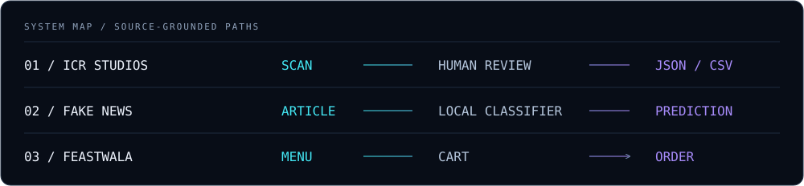
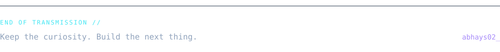

<p align="center">
  
</p>

<p align="center">
  <strong>Turn an idea into a system. Make the system useful.</strong><br />
  Machine-learning experiments, thoughtful interfaces, and the software connecting them.
</p>

<p align="center">
  <a href="#about">ABOUT</a> &nbsp; / &nbsp;
  <a href="#projects">PROJECTS</a> &nbsp; / &nbsp;
  <a href="#tech-stack">TECH STACK</a> &nbsp; / &nbsp;
  <a href="#statistics">STATISTICS</a> &nbsp; / &nbsp;
  <a href="#connect">CONNECT</a>
</p>

## ABOUT

```text
> identify
  USER     abhays02
  FOCUS    applied ML / full-stack
  SIGNAL   open source
  MODE     building + learning + exploring
```

I build across Python and the web: text-classification tools, document-review workflows, and applications with real user journeys. I like turning a model or an idea into something people can inspect and use—not just a notebook result.

My recent work explores local document processing and small, reproducible ML experiments. Deep learning, system design, and full-stack development are ongoing learning threads.

## PROJECTS

**Selected systems / from input to useful output**



### 01 / ICR Studios

**A local workspace for inspecting scanned forms, saving human corrections, and exporting traceable data.**

Built around the gap between a scanned document and a reviewed record: retain the original pixels, inspect regions, and keep corrections distinct from raw evidence.

`Python` `FastAPI` `React` `TypeScript` `SQLAlchemy`

**Scope:** manual-review prototype with encrypted local storage. Local OCR needs separately approved weights and runtime verification; handwriting accuracy is not established.

[**EXPLORE REPOSITORY →**](https://github.com/abhays02/ICR-Studios) · [Review workflow & limitations](https://github.com/abhays02/ICR-Studios/blob/main/docs/STATUS.md)

---

### 02 / Fake News Detection

**A browser extension backed by a local API for classifying article text.**

Connects reading in the browser to a TF-IDF + logistic-regression baseline, with training scripts and saved model artifacts alongside the extension.

`Python` `scikit-learn` `FastAPI` `JavaScript`

**Scope:** a text-classification experiment, not an independent fact-checker. The extension expects a locally running backend; feedback storage is not implemented.

[**VIEW SOURCE →**](https://github.com/abhays02/fakenews-Detection) · [Inspect model training](https://github.com/abhays02/fakenews-Detection/blob/main/model/train.py)

---

### 03 / Feastwala

**A food-ordering web application with menu browsing, carts, and customer/admin order flows.**

Brings the ordering journey into one application, from choosing food to managing an order, using server-rendered pages and database-backed models.

`JavaScript` `Node.js` `Express` `EJS` `MongoDB`

**Scope:** application source and local setup are available. Hosted availability and production operation are not asserted here.

[**EXPLORE REPOSITORY →**](https://github.com/abhays02/feastwala) · [Trace the application routes](https://github.com/abhays02/feastwala/blob/main/routes/webRouter.js)

**Further signals** · [Movie Recommendation System](https://github.com/abhays02/Movie-Recommendation-System): a content-based notebook using movie-overview TF-IDF and a sigmoid similarity kernel. · [grokking-silence](https://github.com/abhays02/grokking-silence): a small NumPy modular-addition experiment with its run log.

## TECH STACK

**Tools visible in the work above—not proficiency scores.**

| Layer | Working materials |
| :--- | :--- |
| Languages | `Python` · `JavaScript` · `TypeScript` |
| Interfaces | `React` · `HTML / CSS` · `EJS` |
| Services | `FastAPI` · `Node.js` · `Express` |
| ML & data | `scikit-learn` · `NumPy` · `pandas` · `Jupyter` |
| Storage | `MongoDB / Mongoose` · `SQLAlchemy` |

## STATISTICS

**Public signals / timestamped snapshots from GitHub's public API**

<p>
  
  
</p>

These cards use GitHub's public repository API. Language counts reflect each original repository's **primary language**, not proficiency or lines of code. If an image is unavailable, [browse the source repositories directly](https://github.com/abhays02?tab=repositories).

### CONTRIBUTION TRACE

<picture>
  <source media="(prefers-color-scheme: dark)" srcset="https://raw.githubusercontent.com/abhays02/abhays02/output/github-snake-dark.svg" />
  <source media="(prefers-color-scheme: light)" srcset="https://raw.githubusercontent.com/abhays02/abhays02/output/github-snake.svg" />
  
</picture>

[View the contribution calendar](https://github.com/abhays02) · [Refresh setup & maintenance](docs/profile-maintenance.md)

## CONNECT

Open to collaborating on useful software, applied ML, and open-source projects. Start with a repository: explore the code, open an issue, or bring a concrete idea.

[**EXPLORE ALL PUBLIC REPOSITORIES →**](https://github.com/abhays02?tab=repositories) &nbsp; / &nbsp; [**FIND ME ON GITHUB →**](https://github.com/abhays02)


